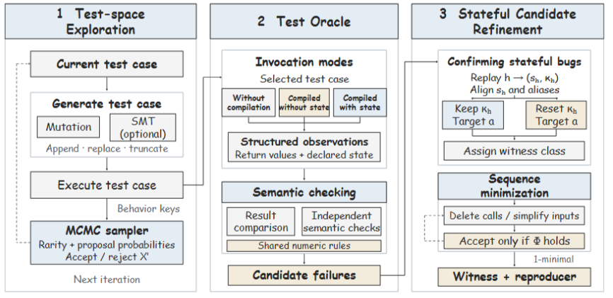

<p align="center">
  
</p>

# Rondo

This is the code repository for the paper **Stateful Testing for Deep Learning Compilers**. Rondo builds a test case as a model paired with an *invocation sequence*, grows that sequence by mutation or SMT synthesis under an adaptive MCMC sampler guided by compilation-behaviour feedback, checks each case in three invocation modes, and confirms stateful bugs by replaying the exposing invocation with compiler state retained and reset. It supports PyTorch, TensorFlow, JAX and MindSpore, and ships a framework-free reference backend.



The repository includes the testing engine in `rondo/` and [117 bug reports](issues/). The three modules are *Test-space Exploration*, *Test Oracle* and *Stateful Candidate Refinement*.

## Setup

Rondo runs on Python 3.10 or newer and needs no third-party package on the reference backend. SMT-based synthesis uses the optional `z3-solver`; without it, Rondo falls back to an enumerator over the declared shape domain.

```bash
python -m pip install z3-solver   # optional
```

Run the commands below from this directory.

## Smoke test

Classify the paper's running example (`A` at `w = 2`, update `w <- 4`, then `B = return(A)`) end to end:

```bash
python -m rondo.cli witness
```

It prints the three mode observations, the oracle's candidate class, and the witness class after the controlled replay. `python -m rondo.cli method` prints the three modules.

## Full searches

Run the exploration chain on the reference backend and report what it found:

```bash
python -m rondo.cli search --rounds 200 --seed 0
```

`--rounds` is the number of chain decisions and `--seed` fixes the sampler. Each round proposes a sequence, runs it for behaviour feedback, decides acceptance, and checks the oracle; confirmed candidates are classified and minimized. The command reports the rounds, oracle checks, candidates, and confirmed witnesses by class.

To search a real framework, build the matching adapter (it requires that framework to be installed) and pass it to the engine:

```python
from rondo import Rondo, RondoConfig
from rondo.adapters import PyTorchAdapter
from rondo.domain import Scenario

adapter = PyTorchAdapter(scenario, model_factory, state_factory)
result = Rondo(adapter, RondoConfig(seed=0, exploration_rounds=500)).run()
print(result.summarize())
```

## Bug reports

`issues/` holds 117 problem packages Rondo found on production compilers: 30 PyTorch, 30 TensorFlow, 17 JAX and 40 MindSpore. Each package is a single Markdown write-up with the symptom, a minimal reproducer, controls, and the root-cause analysis. `issues/INDEX.md` lists every package by framework and defect category.

## License

[MIT](LICENSE) © 2026 Anonymous Authors.
